# Project One — logic maps

This is a Mermaid-first map of the implemented platform logic. It is derived from
`README.md`, `PRODUCT.md`, `docs/ARCHITECTURE.md`, phase documents, ADRs, API routes,
and the backend module/state-machine code. It is deliberately local-only: see `.gitignore`.

## 1. End-to-end engagement

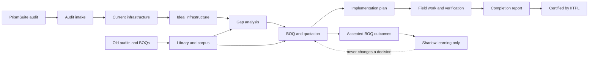

## 2. System shape and trust boundaries

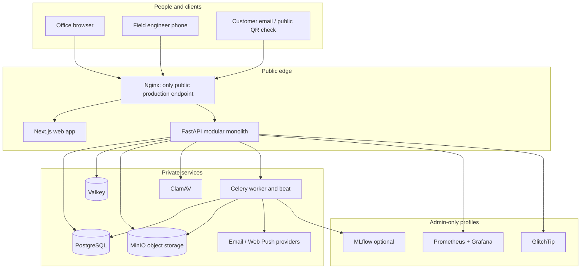

## 3. Backend modules and permitted dependencies

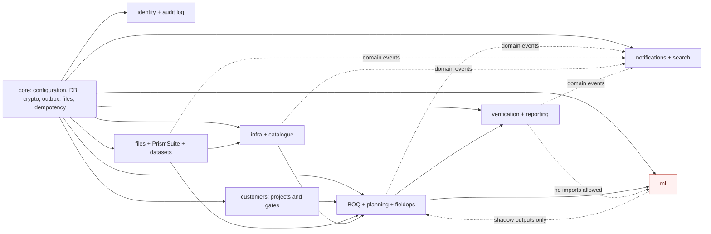

Rules: modules import another module only through `contracts.py` or react to an outbox event;
`core` imports no module; verification and reporting cannot import ML.

## 4. Protected request and write path

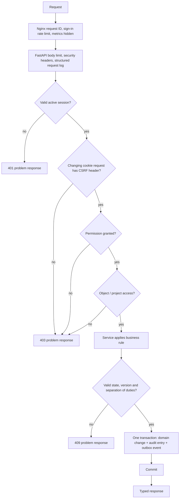

## 5. Eight-stage gate protocol

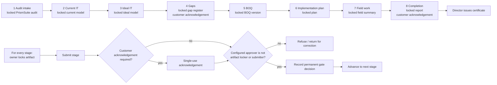

## 6. Audit import and document corpus

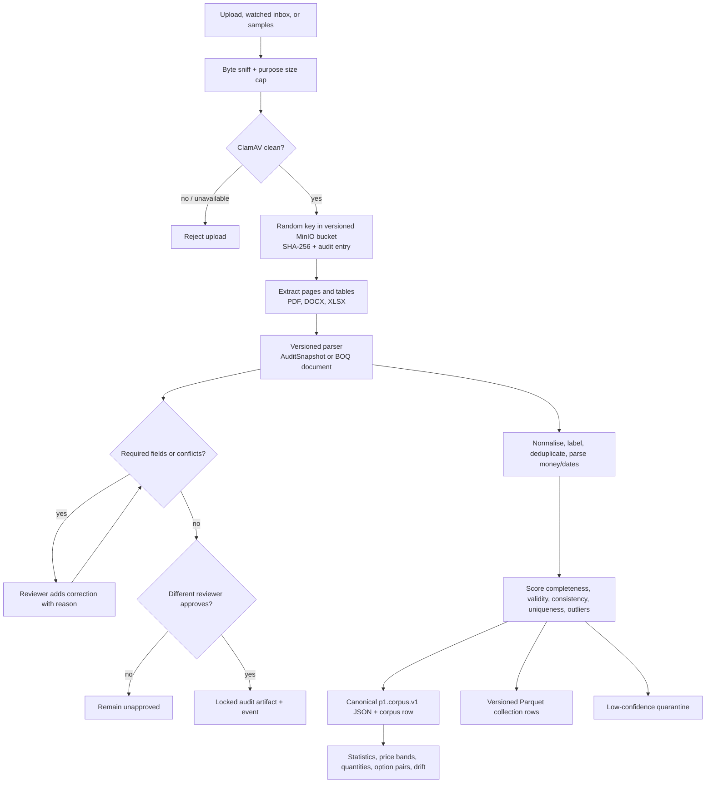

## 7. Infrastructure, gaps, BOQ, and quote controls

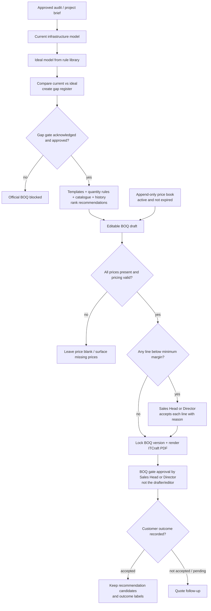

An early **estimate** may be drafted from a report before approvals; it is visibly “estimate,
not approved” and does not replace the official, gap-register-based BOQ.

## 8. Planning and field task state machine

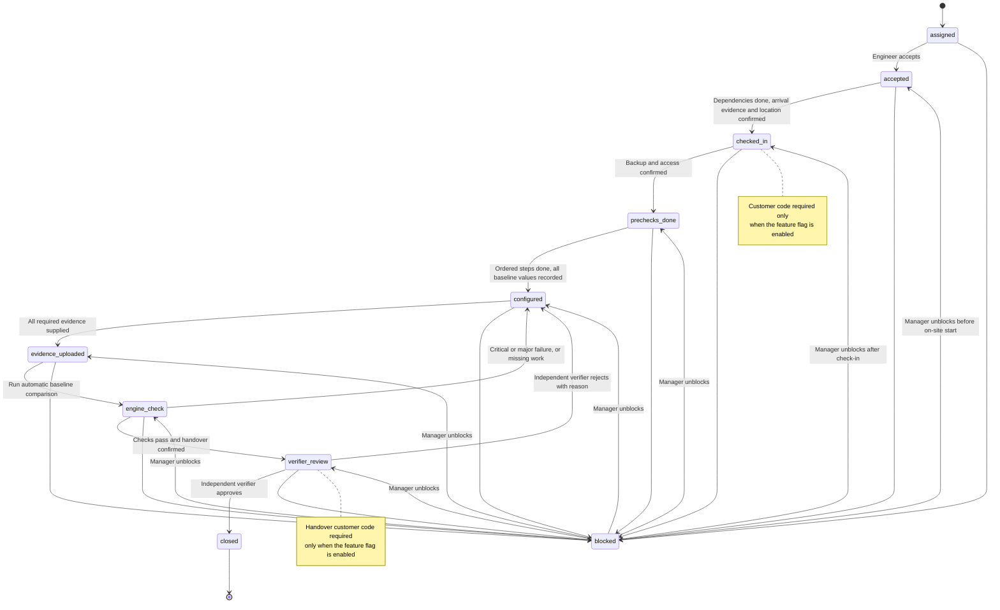

Each field action carries a client event ID and capture time for idempotent, offline sync up to
72 hours. The doer may never verify their own task; the phone receives neither prices nor other
roles’ answers.

## 9. Configuration check and deviations

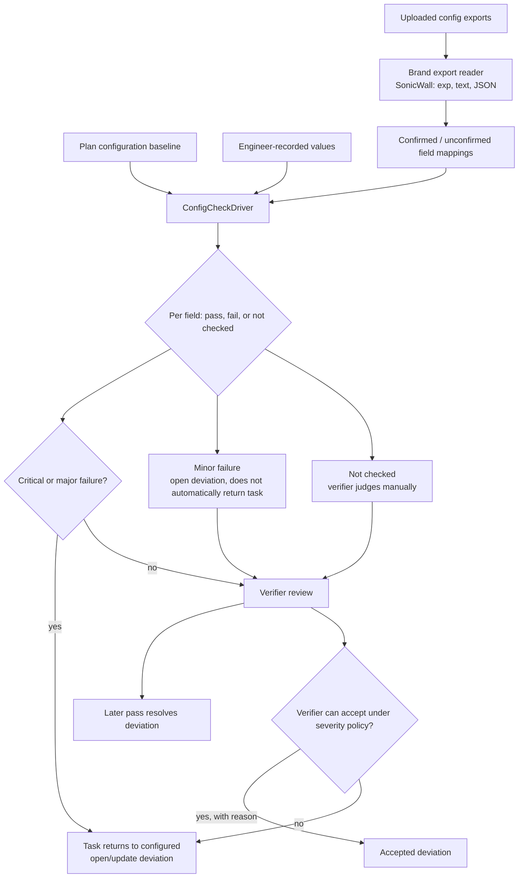

## 10. Completion report and certificate release logic

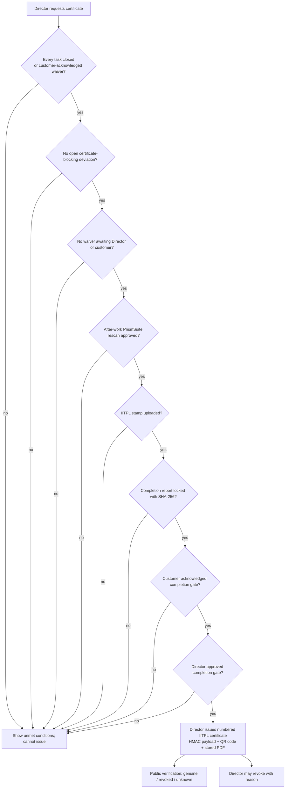

## 11. Transactional outbox and asynchronous work

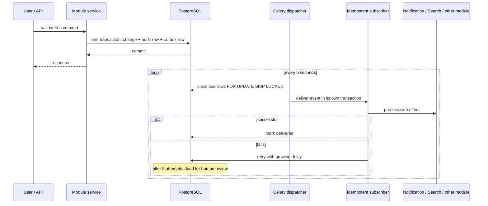

## 12. Learning lifecycle — constrained to shadow mode

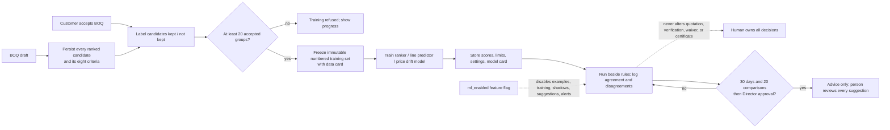

## 13. Persistence and immutability model

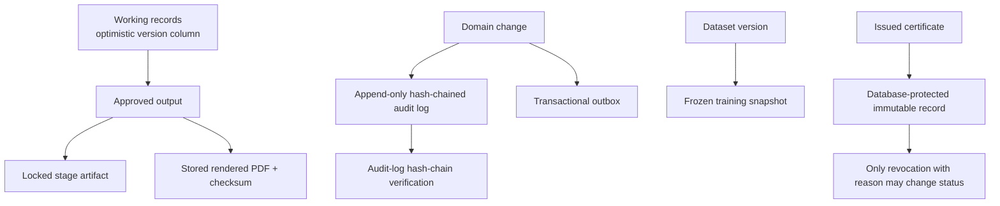

## Source map

- Architecture and module boundaries: `docs/ARCHITECTURE.md`
- Stage gates and field states: `backend/app/modules/customers/stages.py`,
  `docs/phases/phase-08-field-operations.md`
- Verification and certificate controls: phases 9–10 and ADRs 0019, 0022, 0025
- BOQ and margin logic: phases 5–6 and ADRs 0021, 0024, 0028
- Learning constraints: phase 13 and ADRs 0020, 0029
